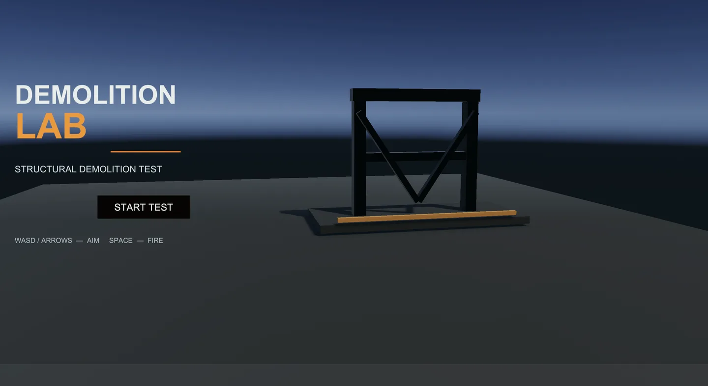
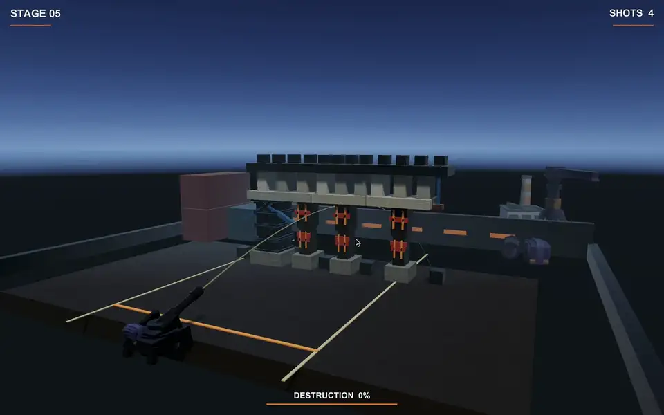
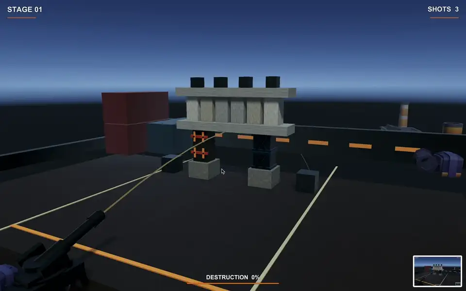
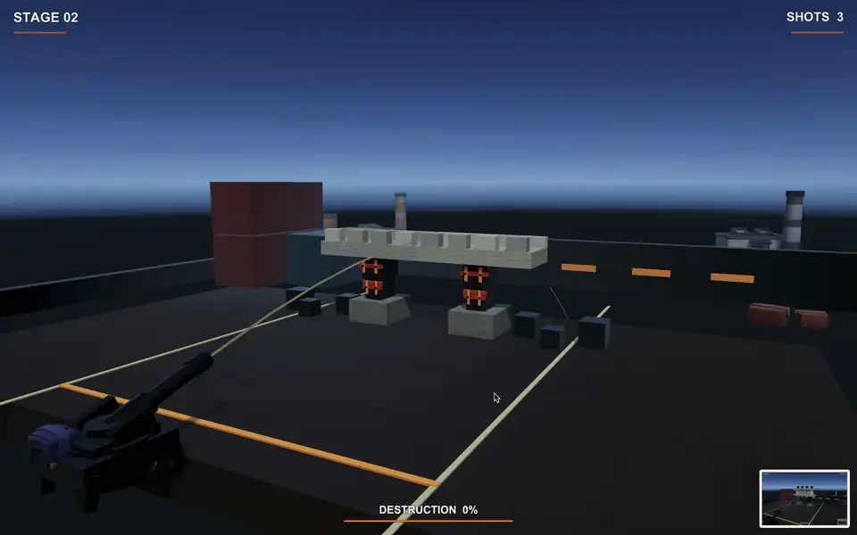
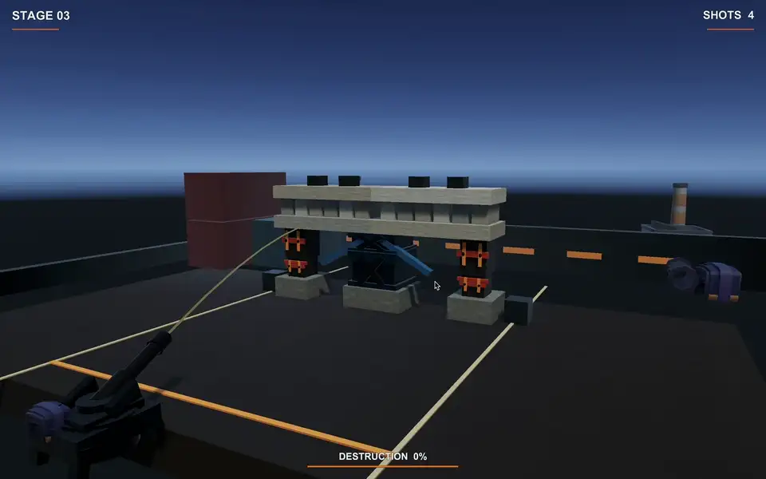
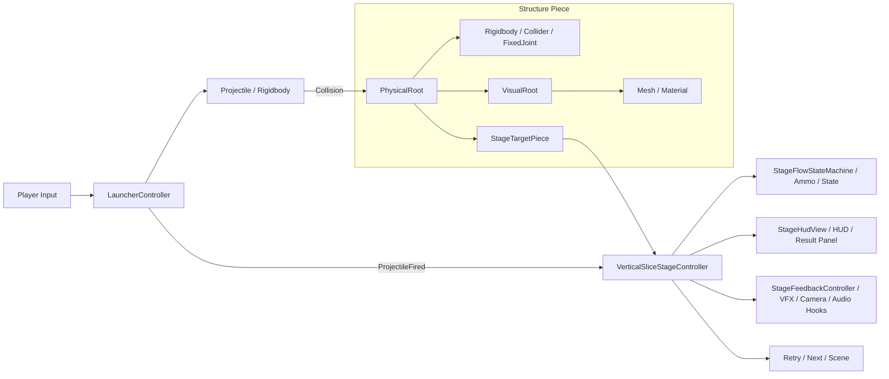

# Demolition Lab

제한된 포탄으로 구조물의 약한 지점을 찾아 무너뜨리는 5스테이지 물리 퍼즐입니다.



| | |
| --- | --- |
| Engine | Unity 6.5 (`6000.5.10f1`) / URP |
| Language | C# |
| Platform | macOS |
| Development | 개인 프로젝트 |
| Role | 1인 개발 — 게임플레이 / 물리 시스템 / 스테이지 / 검증 도구 |
| Core | Rigidbody, FixedJoint, 상태 머신, 물리 디버깅·측정 |

## 게임 소개

플레이어는 포물선 궤적을 보며 포탄을 발사합니다. 탄약이 넉넉하지 않기 때문에 아무 곳이나 맞히기보다, 구조물을 받치고 있는 Weak 지점을 골라야 합니다. 목표 파괴율은 70%이며, 탄약을 모두 쓰면 남은 붕괴를 잠시 기다린 뒤 성공과 실패를 판정합니다.

처음에는 Rigidbody 몇 개가 무너지는 간단한 실험이었습니다. 이후 조준과 탄약, 파괴율, Retry/Next, 다섯 개의 스테이지를 붙여 짧게나마 처음부터 끝까지 플레이할 수 있는 게임으로 만들었습니다.



- `WASD` / 방향키: 조준
- `Space`: 발사
- `R`: 현재 스테이지 재시작
- 스테이지별 탄약: 3–4발

## 스테이지

| Stage | 구조 | 의도 | Ammo |
| --- | --- | --- | ---: |
| 01 | 작은 게이트 | 눈에 띄는 Weak 지점을 맞히는 기본 조작 | 3 |
| 02 | 두 구간으로 나뉜 교량 | 지지대 하나를 없애도 반대쪽이 남는 구조 | 3 |
| 03 | 중앙이 보강된 낮은 벙커 | 단단한 중앙보다 약한 측면을 고르는 문제 | 4 |
| 04 | 세 개의 하부 지지 경로를 가진 타워 | 공격 순서에 따라 달라지는 큰 붕괴 | 4 |
| 05 | 비대칭 산업용 갠트리 | 앞에서 익힌 Weak/Reinforced 구분을 함께 사용 | 4 |

| Stage01 | Stage02 |
| --- | --- |
|  |  |

| Stage03 | Stage05 |
| --- | --- |
|  |  |

## 최종 구조

최종 버전의 물리 구조는 생각보다 단순합니다. 구조물 조각은 대부분 `Rigidbody`와 `Collider`로 움직이고, 실제 플레이에 필요한 지지부에만 `FixedJoint`를 사용했습니다.

개발 중에는 연결 그래프, 무게중심, 국소 지지와 하중 전달까지 여러 방식을 시도했습니다. 하지만 규칙을 많이 넣을수록 구조물이 보이지 않는 힘으로 붙잡힌 것처럼 움직이거나 고무처럼 흔들렸습니다. 플레이어 입장에서는 계산이 정교한 것보다 “어디가 약하고, 왜 무너졌는지”가 보이는 편이 더 중요하다고 판단해 핵심 연결만 남겼습니다.



### 물리와 외형 분리

구조물의 질량, Collider, Joint와 파괴 판정은 `PhysicalRoot`에 둡니다. 화면에 보이는 메시와 머티리얼은 그 아래 `VisualRoot`로 분리했습니다. 덕분에 외부 메시를 교체해도 Collider 크기나 Joint 위치가 함께 바뀌지 않습니다.

### 게임 규칙과 표시 책임 분리

`VerticalSliceStageController`는 초기화, 탄약, 목표 집계, 승패와 씬 진행을 조정합니다. UI 표시는 `StageHudView`, 발사·충돌·붕괴 연출은 `StageFeedbackController`로 분리했습니다. HUD는 목표물을 평가하지 않고, 연출은 탄약이나 승패를 변경하지 않습니다. 상태 전환 규칙은 Unity 컴포넌트와 독립된 일반 C# 클래스 `StageFlowStateMachine`에 둡니다.

상속 계층을 늘리기보다 역할이 분명한 컴포넌트를 조합했습니다. 주요 런타임 코드는 다음과 같습니다.

- [`LauncherController.cs`](Assets/Scripts/Gameplay/Launching/LauncherController.cs): 조준, 궤적 표시, 포탄 생성
- [`Projectile.cs`](Assets/Scripts/Gameplay/Launching/Projectile.cs): 초기 속도와 질량 설정, 충돌 접점과 impulse 기록
- [`StageTargetPiece.cs`](Assets/Scripts/Gameplay/Stage/StageTargetPiece.cs): 이동·낙하·회전량으로 파괴 여부 판정
- [`CriticalSupportJoint.cs`](Assets/Scripts/Gameplay/Structure/CriticalSupportJoint.cs): Unity Joint 파손 콜백과 표시·연출 통지
- [`StageFlowStateMachine.cs`](Assets/Scripts/Gameplay/Stage/StageFlowStateMachine.cs): 스테이지 상태 전이
- [`VerticalSliceStageController.cs`](Assets/Scripts/Gameplay/Stage/VerticalSliceStageController.cs): 탄약, 파괴율, 결과와 씬 진행
- [`StageHudView.cs`](Assets/Scripts/Presentation/UI/StageHudView.cs): HUD와 결과 패널 표시
- [`StageFeedbackController.cs`](Assets/Scripts/Presentation/Feedback/StageFeedbackController.cs): 발사·충돌·붕괴의 시각·오디오 연출

제작 도구도 씬 배치, UI 생성, 연출 제작과 검증을 구분했습니다. 연구용 `StructureManager`에서는 그래프 탐색을 `StructuralGraphTraversal`, 로그·관통 진단·기즈모를 `StructuralDiagnostics`로 분리했습니다. 연구 알고리즘을 최종 게임에 다시 도입한 것은 아닙니다. 구체적인 변경 범위와 보존 조건은 [리팩토링 기록](docs/refactoring-plan.md)에 정리했습니다.

## 시도했던 방법과 최종 판단

한 번에 지금 구조를 만든 것은 아닙니다. 단순 Rigidbody에서 시작해 구조물의 안정성을 설명할 규칙을 하나씩 붙였고, 실제 플레이와 맞지 않는 부분은 다시 걷어냈습니다.

| 단계 | 시도한 것 | 실제 플레이에서 확인한 문제 |
| --- | --- | --- |
| M0 | Rigidbody만 사용 | 구조 관계가 없어 마찰과 접촉 상태에 결과가 크게 좌우됨 |
| M1 | 바닥에서 BFS로 연결된 조각 탐색 | 연결되어 있다는 사실만으로 안정성을 판단할 수 없음 |
| M2 | 질량을 반영한 무게중심과 지지 구간 | 올바르게 분리해도 붕괴가 자연스럽지는 않았음 |
| M3 | 수직 접촉과 국소 지지 전파 | 논리 규칙이 보이지 않는 고정 장치처럼 느껴짐 |
| M4 | 충격량에 따라 끊어지는 논리 연결 | 테스트에 넣은 충격량과 실제 포탄의 충격량이 달랐음 |
| M5 | ConfigurableJoint로 힘과 토크 전달 | Joint가 많아지면서 구조물이 끈적하고 고무처럼 움직임 |
| Final | 필요한 지지부에만 FixedJoint 사용 | 약점과 붕괴 과정을 가장 쉽게 읽을 수 있었음 |

M0–M5의 씬과 코드는 최종 게임에서 실행하지 않습니다. 대신 어떤 가정을 세웠고 왜 버렸는지 확인할 수 있도록 개발 기록으로 남겼습니다.

## 개발하면서 겪은 문제

### 멀쩡해 보이던 교량이 혼자 무너졌다

Stage02는 플레이어가 발사하기도 전에 무너졌습니다. 처음에는 Joint가 약하거나 PhysX가 불안정한 문제라고 생각했습니다. 그런데 약 1초 뒤 위치와 회전을 측정해 보니 최대 `0.94 m`, `47°`까지 움직였지만 Joint는 `4/4` 모두 살아 있었습니다.

문제는 강도가 아니라 배치였습니다. deck의 중심은 약 `±2.0`, pier는 약 `±3.25`에 있어 하중을 받아야 할 위치와 지지대가 어긋나 있었습니다. 지지대를 deck 아래로 옮긴 뒤 10초 동안 확인한 결과, 최대 이동은 `0.014 m`, 회전은 `0.3°`였고 Joint도 모두 유지됐습니다.

### 시작하자마자 스테이지가 Clear 처리됐다

목표물이 자신의 시작 위치를 저장하기 전에 `VerticalSliceStageController`가 파괴율을 계산하면서 생긴 문제였습니다. 초기 위치가 제대로 잡히지 않아 모든 목표물이 이미 움직인 것으로 판단됐고, 발사 입력도 바로 막혔습니다.

목표물의 기준 위치를 먼저 저장하고, 다음 프레임부터 판정을 시작하도록 순서를 나눴습니다. 스테이지 흐름도 `Initializing → Ready → Active → Settling → Clear/Failed` 상태로 구분해 초기화 중에는 목표물의 파괴 판정을 비활성화하고, 플레이 활성화와 최소 한 번의 발사 이후 성공 여부를 평가하도록 했습니다.

### 자동 테스트는 통과했는데 실제 포탄으로는 끊어지지 않았다

M4 테스트에서는 Weak 연결에 `60 N·s`의 충격량을 넣었습니다. 테스트는 통과했지만 당시 실제 플레이에서 측정한 직격 impulse는 약 `29.7–35.2 N·s`였습니다. 구현보다 테스트 입력이 실제 상황과 동떨어져 있던 셈입니다.

실제 충돌 로그를 기준으로 값을 다시 맞췄고, 중력에 의한 하중과 순간 충격량도 같은 수치처럼 더하지 않고 각각의 capacity와 비교하도록 바꿨습니다. 이 경험 이후 자동 테스트의 성공 여부뿐 아니라, 테스트가 사용하는 입력이 실제 게임을 대표하는지도 함께 확인했습니다.

## AI 도구 사용

Codex와 ChatGPT를 코드 초안, Unity Editor용 씬 빌더와 검증 도구, 로그 정리, 문서 작성에 사용했습니다. 특히 반복 작업을 빠르게 만들고 여러 구현 방식을 비교하는 데 도움을 받았습니다.

초기에는 생성된 코드를 빠르게 적용한 뒤 Play Mode 결과를 확인하는 비중이 컸습니다. 하지만 컴파일 성공과 실제 동작이 다른 경우가 계속 나왔습니다. 연결성 테스트를 통과한 구조물이 부자연스럽게 고정되거나, 합성 충격 테스트는 성공했지만 실제 포탄으로는 연결이 끊어지지 않는 식이었습니다.

그래서 작업 방식도 바뀌었습니다. 먼저 원하는 플레이 결과와 검증 기준을 정하고, AI를 활용해 구현·수정한 결과를 자동 검증과 직접 Play Mode 테스트로 확인했습니다. 로그와 측정값이 예상과 다르면 원인을 다시 추적해 구현을 수정하거나 접근 자체를 폐기했습니다. 최종 버전에서 연구 시스템을 모두 합치지 않고 단순한 FixedJoint 구조로 돌아온 것도 이 검증 과정에서 내린 선택입니다.

## 실행 방법

1. 현재 리팩토링이 반영된 `vertical-slice` 브랜치를 받습니다.
2. Unity Hub에서 Unity `6000.5.10f1`을 설치하고 프로젝트를 엽니다.
3. 컴파일 오류와 Missing Script가 없는지 확인합니다.
4. `Assets/Scenes/VerticalSlice_Title.unity`를 엽니다.
5. Play Mode에서 `START TEST`를 누릅니다.

리팩토링 이전 버전으로 macOS standalone release candidate를 생성한 기록이 있습니다. 현재 코드 분리 변경을 반영한 재빌드·실행 검증은 아직 수행하지 않았습니다. 전체 실행 점검 항목은 [`docs/release-qa.md`](docs/release-qa.md)에 정리했습니다.

### 리팩토링 검증 상태

물리와 게임 규칙을 바꾸지 않고 책임을 분리하는 작업이며, 설정 보존 검사와 실제 Unity 실행 검증을 구분합니다.

| 확인 항목 | 상태 |
| --- | --- |
| Stage01–05 기존 객체 3,912개와 HUD·연출 참조 85개 보존 | 정적 검사 통과 |
| 물리 설정·탄약·목표 목록·씬 진행 및 기존 스크립트 GUID 보존 | 정적 검사 통과 |
| C# 54개 파일 구문 및 로컬 선언·호출 검사 | 통과 — Unity 전체 컴파일은 아님 |
| 실제 상태 머신 소스를 실행한 탄약·상태 전환 검사 | assertion 61개 통과 |
| 리팩토링 후 Unity 컴파일·기존 validator·Play Mode·standalone | **미검증** — 작업 환경에 해당 Unity 버전 미설치 |

저장소 루트에서 Unity 없이 실행할 수 있는 검사입니다. Python 3·Git과 .NET 10 SDK가 필요하며, 상세 범위는 [`Tools/README.md`](Tools/README.md)를 참고하세요.

```sh
python3 Tools/verify_refactoring.py
dotnet run --project Tools/RefactoringChecks/RefactoringChecks.csproj
```

Unity 설치 후에는 `DemolitionLab/Presentation/Validate Final Portfolio Build`와 `DemolitionLab/Release/Validate Release Candidate`를 실행하고, Title→Stage01–05에서 무입력 대기, 발사·탄약, 파괴율, 성공·실패, Retry·Next를 확인해야 합니다. 정적 검사와 상태 머신 테스트만으로 물리 동작이나 플레이 품질이 보장되지는 않습니다.

## 프로젝트 구성

```text
Assets/
├── Scenes/                    # 타이틀, Stage01–05, M0–M5 실험 씬
├── Scripts/
│   ├── Gameplay/
│   │   ├── Launching/         # 조준과 포탄
│   │   ├── Stage/             # 상태 머신, 목표 판정, 스테이지 진행
│   │   └── Structure/         # 최종 게임의 지지부 파손 통지
│   ├── Presentation/
│   │   ├── UI/                # 메뉴와 HUD
│   │   └── Feedback/          # 충돌 연출, 카메라, 오디오 연결
│   ├── Research/
│   │   └── StructuralSimulation/ # M1–M5 구조 실험과 진단
│   └── Utility/               # 리셋 보조
├── Editor/
│   ├── Stages/                # 스테이지 제작과 검증
│   ├── Presentation/          # 환경·외형·HUD·연출 제작과 검증
│   ├── Release/               # 출시 설정과 빌드
│   └── Research/              # M0–M5 제작과 검증
├── Prefabs/                   # 포탄 프리팹
└── Art/                       # 머티리얼, visual prefab, 외부 에셋

Tools/                         # Unity 외부에서 실행하는 리팩토링 검사
docs/                          # 설계 과정, 측정값, QA, 라이선스 기록
```

폴더 분리는 기능을 찾기 위한 구분이며 별도 어셈블리로 격리한 구조는 아닙니다. 기존 씬·프리팹의 스크립트 참조를 유지하도록 `.meta`와 GUID를 보존했습니다.

## 외부 에셋과 범위

게임플레이 코드와 스테이지 흐름, 물리 연결과 검증 도구는 이 프로젝트에서 작성했습니다. 환경 장식에는 Kenney City Kit (Industrial), Kenney Factory Kit, Poly Haven Asphalt 01을 사용했습니다. 자세한 출처와 수정 내용은 [`docs/third-party-assets.md`](docs/third-party-assets.md)에 기록했습니다.

- 실제 구조공학이나 안전 해석을 위한 시뮬레이터가 아닙니다.
- Unity의 Rigidbody/PhysX와 Joint를 사용했으며 별도의 물리 solver는 만들지 않았습니다.
- 현재 AudioClip이 연결되어 있지 않아 게임은 무음으로 실행됩니다.
- 수치와 단계별 기록은 [`docs/portfolio-facts.md`](docs/portfolio-facts.md)와 `docs/`의 개발 문서에서 확인할 수 있습니다.
