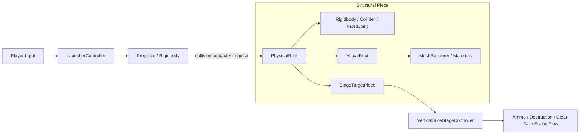

# Demolition Lab

Unity와 C#으로 제작한 물리 기반 구조물 철거 퍼즐입니다.

| 항목 | 내용 |
| --- | --- |
| Engine | Unity 6.5 (`6000.5.10f1`) / URP |
| Language | C# |
| Genre | Physics / Demolition Puzzle |
| Stages | 5 |
| Tested platform | macOS |
| Purpose | 게임 프로그래머 포트폴리오 프로젝트 |

> 현재 저장소에는 실제 플레이 GIF/영상이 포함되어 있지 않습니다. 아래 [미디어 추가 위치](#미디어-추가-위치)에 녹화 파일을 추가할 수 있습니다.

## Gameplay

한정된 포탄으로 구조물의 Weak 지점을 찾아 무너뜨리고 목표 파괴율을 달성합니다.

**Aim → Fire → Weak point 선택 → Rigidbody collapse → Clear/Fail → Retry/Next**

- WASD/방향키 조준과 포물선 궤적 미리보기
- 스테이지별 3–4발의 제한 탄약
- Weak와 Reinforced 지지부의 시각적·물리적 차이
- 실시간 파괴율과 70% 성공 기준
- 탄약 소진 후 붕괴 대기 시간을 거친 Clear/Fail 판정
- `Title → Stage01 → 02 → 03 → 04 → 05 → Completion → Title` 흐름

## Project Overview

최종 게임은 같은 조작과 스테이지 흐름을 공유하는 다섯 개의 짧은 퍼즐로 구성됩니다.

| Stage | Structure | Player lesson | Ammo |
| --- | --- | --- | ---: |
| 01 | 작은 게이트/튜토리얼 | 노출된 Weak 지지부와 기본 붕괴 | 3 |
| 02 | 좌우가 나뉜 긴 교량 | 중복 지지와 부분 붕괴 | 3 |
| 03 | 낮은 Reinforced 벙커 | 강한 중앙 대신 Weak 측면 선택 | 4 |
| 04 | 3개 하부 경로를 가진 고층 타워 | 공격 순서와 대형 연쇄 붕괴 | 4 |
| 05 | 비대칭 산업용 갠트리 | Weak/Reinforced 경로를 종합한 최종 선택 | 4 |

난이도는 단순한 내구도 증가보다 **지지 경로의 중복, 목표 선택, 구조물 크기, 공격 순서**로 확장했습니다.

## Final Architecture

최종 Vertical Slice는 M1–M5 연구 시스템 전체를 실행하지 않습니다. 플레이어가 이해하기 어려운 규칙을 줄이고, 소수의 게임플레이 핵심 연결만 물리 Joint로 유지했습니다.

- `LauncherController`: 조준, 궤적 표시, 포탄 생성
- `Projectile`: Rigidbody 초기 속도, 실제 충돌 접점·impulse 전달, 수명 관리
- `StageTargetPiece`: 초기 기준 상태와 이동/회전/낙하 기반 목표 판정
- `VerticalSliceStageController`: 탄약, 파괴율, 상태 전이, Retry/Next/Completion
- `Rigidbody` + `Collider`: 충돌과 잔해 운동
- 소수의 `FixedJoint`: Weak/Reinforced 핵심 지지 연결
- 스테이지별 Inspector 설정: 탄약, 목표 목록, 성공 기준, settle 시간, 다음 씬



### Physics와 Presentation 분리

`PhysicalRoot`가 Transform, 질량, Collider 크기, Joint anchor와 목표 판정의 기준입니다. 교체 가능한 `VisualRoot`에는 Renderer와 프레젠테이션 메타데이터만 두며 Rigidbody, Collider, Joint를 넣지 않습니다. 이 구조로 외부 메시와 머티리얼을 교체해도 기존 물리 밸런스가 변하지 않도록 했습니다.

## Technical Evolution

이 프로젝트의 핵심은 현실적인 구조 해석기를 구현했다는 주장이 아니라, **단순화된 모델을 실제 플레이 결과와 반복 비교하고 필요할 때 더 단순한 구조로 되돌린 과정**입니다.

| Iteration | Implementation | Gameplay finding |
| --- | --- | --- |
| M0 | 순수 Rigidbody 구조물 | 구조 관계가 없어 붕괴가 마찰·접촉·변위에 크게 의존 |
| M1 | Ground anchor에서 BFS를 수행하는 그래프 연결성 | **Connected ≠ Stable** |
| M2 | 질량 가중 COM과 지면 support interval | 올바른 release가 자연스러운 collapse를 보장하지 않음 |
| M2.1 | Collider gap/관통 검사, 질량 정규화, physics handoff 수정 | **Global stability ≠ Local support** |
| M3 | 수직 접촉과 제한된 cantilever 전파 | 논리 연결이 보이지 않는 강체 결합처럼 느껴짐 |
| M4/M4.1 | breakable logical connection과 정규화 utilization | 합성 테스트 입력과 실제 플레이 impulse 분포가 다름 |
| M5/M5.1 | ConfigurableJoint force/torque 전달과 stiffness 보정 | 많은 Joint가 구조물을 끈적하고 고무처럼 만들어 직관성을 저해 |
| Final | 게임플레이 핵심 `FixedJoint`만 유지 | 세부 모델보다 읽기 쉬운 약점과 결정적인 붕괴를 우선 |

결론적으로 더 복잡한 시뮬레이션이 항상 더 좋은 게임플레이를 만들지는 않았습니다. M0–M5 씬과 코드는 이 판단에 도달한 연구 기록으로 저장소에 남겨 두었습니다.

## Key Technical Problems / Debugging

### A. 빌드 성공 후 Play Mode 발사 실패

- **관찰:** `Space` 입력 시 `The Object you want to instantiate is null` 예외 발생
- **원인:** `LauncherController`의 serialized `projectilePrefab` 씬 참조 누락
- **수정:** 씬 빌더에서 참조를 명시적으로 연결하고 필수 참조 검증 추가
- **교훈:** 컴파일과 빌드 성공만으로 런타임 Inspector 배선을 검증할 수 없음

### B. Stage02 교량의 시작 직후 자가 붕괴

- **관찰:** 약 1초 후 최대 약 `0.94 m` 이동, `47°` 회전이 발생했지만 Joint는 `4/4` 모두 유지
- **초기 추정:** Joint 강도 또는 PhysX 불안정
- **실제 원인:** deck 중심은 약 `±2.0`, pier는 약 `±3.25`에 있어 지지 형상이 deck 하중 아래 정렬되지 않음
- **수정:** pier와 foundation을 각 deck 지지 위치 아래로 이동
- **검증:** 10초 idle 검사에서 최대 이동 `0.014 m`, 회전 약 `0.3°`, Joint `4/4` 유지

Joint 생존 여부와 실제 변위를 함께 측정해, 강도 튜닝이 아닌 authored geometry 문제임을 확인했습니다.

### C. Stage 시작 직후 자동 Clear와 입력 비활성화

- **관찰:** 플레이어가 발사하기 전에 목표가 파괴된 것으로 계산되고 launcher가 비활성화됨
- **원인:** `VerticalSliceStageController.Awake`가 `StageTargetPiece` 기준 Transform 초기화보다 먼저 평가될 수 있었음
- **수정:** 기준 상태를 명시적으로 초기화하고 다음 상태 머신을 도입

`Initializing → Ready → Active → Settling → Clear / Failed`

`Active` 이전에는 파괴 판정을 하지 않으며, 성공 판정에는 실제 발사 이력이 필요합니다.

### D. 자동 테스트는 통과했지만 Weak 연결이 깨지지 않음

- **관찰:** M4 자동 Weak 테스트는 통과했지만 수동 플레이에서는 연결이 유지됨
- **원인:** 테스트의 합성 impulse는 `60 N·s`였고, 당시 실제 Weak 직격은 대략 `29.7–35.2 N·s` 범위였음
- **수정:** `gravityLoad / gravityCapacity`와 `impactImpulse / impactCapacity`를 분리한 dimensionless utilization 모델로 변경하고 실제 입력 범위에 맞춰 보정
- **교훈:** 테스트가 사용하는 입력 분포도 실제 게임 데이터로 검증해야 함

## AI-Assisted Development & Verification

AI coding assistant를 구현 초안, 반복적인 Editor validator, 로그 분석 보조와 문서화에 사용했습니다. 생성된 결과를 정답으로 간주하지 않았으며, 최종 판단은 Play Mode 관찰과 측정값을 기준으로 내렸습니다.

자동화만으로 발견하지 못한 사례는 다음과 같습니다.

1. 컴파일/빌드는 성공했지만 `projectilePrefab` 참조가 null이었던 문제
2. BFS 연결성 테스트는 통과했지만 시각적으로 부자연스러운 구조가 고정된 문제
3. COM 로직은 통과했지만 Collider 관통과 질량 편향이 physics handoff를 망친 문제
4. M4 합성 load 테스트는 통과했지만 실제 projectile impulse로는 연결이 끊어지지 않은 문제
5. Stage02 문제를 Joint 강도 추측이 아니라 변위·회전·생존 Joint 측정으로 진단한 사례

실제 개발 루프는 다음과 같았습니다.

**Hypothesis → AI-assisted implementation → Automated validation → Manual observation → Measurement/logging → Model revision**

AI는 구현 속도를 높이는 도구로 사용했고, 모델 선택·축소와 최종 게임플레이 판단은 반복 검증 결과를 바탕으로 결정했습니다.

## Tech Stack

- Unity `6000.5.10f1` / Unity 6.5
- C#
- Unity PhysX, Rigidbody, Collider
- FixedJoint — 최종 게임의 핵심 연결
- ConfigurableJoint — M5 연구와 calibration
- Universal Render Pipeline (URP)
- Unity Input System
- Git

## Project Structure

```text
Assets/
├── Scenes/
│   ├── VerticalSlice_Title.unity
│   ├── VerticalSlice_Stage01–05.unity   # 최종 플레이 게임
│   └── M0–M5.unity                      # 구조 모델 연구 기록
├── Scripts/                              # 런타임 게임/물리/스테이지 코드
├── Editor/                               # 씬 빌더와 자동 검증 도구
└── Art/
    ├── Materials/                        # 프로젝트용 URP 머티리얼
    ├── Prefabs/                          # physics와 분리된 visual prefab
    └── ThirdParty/                       # 외부 원본 에셋

docs/                                    # 단계별 설계, 측정, QA, 라이선스 기록
```

주요 검토 시작점:

- [`LauncherController.cs`](Assets/Scripts/LauncherController.cs)
- [`Projectile.cs`](Assets/Scripts/Projectile.cs)
- [`StageTargetPiece.cs`](Assets/Scripts/StageTargetPiece.cs)
- [`VerticalSliceStageController.cs`](Assets/Scripts/VerticalSliceStageController.cs)
- [`PhysicsPresentationSeparationBuilder.cs`](Assets/Editor/PhysicsPresentationSeparationBuilder.cs)
- [`portfolio-facts.md`](docs/portfolio-facts.md)

## How to Run

### Unity Editor

1. Unity Hub에서 저장소 폴더를 Unity `6000.5.10f1`로 엽니다.
2. `Assets/Scenes/VerticalSlice_Title.unity`를 엽니다.
3. Play Mode를 시작하고 `START TEST`를 누릅니다.

### Standalone

macOS release candidate는 별도 배포 파일로 제공할 수 있습니다. GitHub Release에 첨부된 경우 ZIP을 내려받아 압축을 풀고 `Demolition Lab.app`을 실행합니다. 생성된 `Builds/` 폴더는 저장소에 커밋하지 않습니다.

릴리스 수동 검증 항목은 [`docs/release-qa.md`](docs/release-qa.md)를 참고하세요.

## Controls

| Input | Action |
| --- | --- |
| `WASD` / Arrow Keys | Aim |
| `Space` | Fire |
| `R` | 현재 씬 재시작 |
| Result panel buttons | Retry / Next / 최종 Title 복귀 |

## Third-Party Assets

게임플레이 코드, 물리 연결, 스테이지 흐름과 검증 도구는 프로젝트 코드입니다. 최종 환경과 장식에는 다음 외부 아트 에셋을 사용했습니다.

- Kenney City Kit (Industrial), CC0
- Kenney Factory Kit, CC0
- Poly Haven Asphalt 01, CC0

외부 메시를 project-owned visual prefab으로 감싸고 URP 머티리얼과 배치를 적용했습니다. 해당 원본 아트를 직접 제작한 것으로 주장하지 않습니다. 전체 출처·라이선스·수정 기록은 [`docs/third-party-assets.md`](docs/third-party-assets.md)에 있습니다.

현재 외부 오디오 에셋은 사용하지 않으며, 런타임 audio hook에는 AudioClip이 할당되어 있지 않습니다.

## Limitations

- 실제 구조공학 또는 안전 해석을 위한 시뮬레이션이 아닌 게임플레이용 단순 모델입니다.
- Unity 내장 Rigidbody/PhysX와 Joint를 사용하며 custom constraint solver가 없습니다.
- deformable material, stress tensor, fracture mesh, fatigue, plastic deformation을 구현하지 않았습니다.
- 최종 게임은 M1–M5 그래프/COM/load 모델을 사용하지 않습니다.
- 다섯 스테이지로 구성된 포트폴리오 규모의 짧은 게임입니다.
- 자동 검증은 상태와 설정 회귀를 확인하지만 붕괴의 재미와 시각적 품질은 수동 플레이가 필요합니다.
- 현재 저장소에는 실제 SFX가 포함되어 있지 않습니다.

## Selected Development History

| Commit | Change |
| --- | --- |
| `9eea624` | `feat: build M0 playable demolition prototype` |
| `bbaa621` | `fix: wire projectile reference for M0 firing` |
| `f466451` | `feat: add graph-based structural support prototype` |
| `995ff4e` | `feat: add center-of-mass structural stability model` |
| `4f4321c` | `fix: normalize M2 physics handoff` |
| `1076cc4` | `feat: add local structural support validation` |
| `9ce3bd8` | `fix: normalize structural connection load model` |
| `d216c42` | `fix: calibrate physical joint response` |
| `216f8c9` | `feat: build first demolition vertical slice` |
| `5f0902c` | `fix: stabilize reusable vertical slice stage flow` |
| `e7de754` | `feat: add final industrial demolition stage` |
| `24d15ae` | `balance: finalize vertical slice difficulty curve` |
| `41530a5` | `refactor: separate physics and presentation geometry` |
| `9d85f0e` | `chore: prepare portfolio release candidate` |

더 자세한 수치와 단계별 판단 근거는 [`docs/portfolio-facts.md`](docs/portfolio-facts.md)와 `docs/`의 milestone 문서를 참고할 수 있습니다.

## 미디어 추가 위치

녹화한 플레이 영상을 GIF 또는 압축된 MP4/WebM으로 변환한 뒤 다음 경로에 배치하는 구성을 권장합니다. 현재 파일은 생성하지 않았습니다.

```text
docs/media/stage01-collapse.gif
docs/media/stage02-support.gif
docs/media/stage04-tower.gif
docs/media/stage05-final.gif
```

README 상단에는 한 개, Gameplay 섹션에는 최대 2–3개의 짧은 클립만 사용하는 편이 저장소 가독성과 로딩 시간에 적합합니다.
